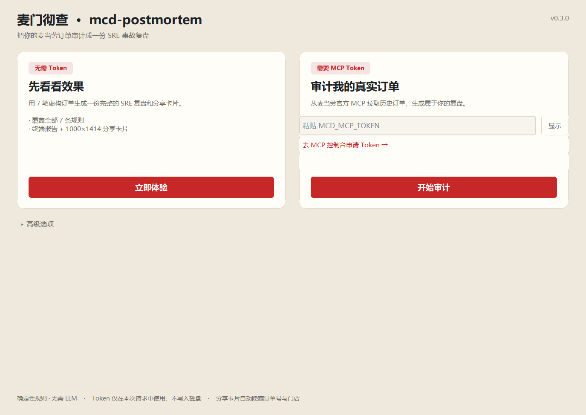
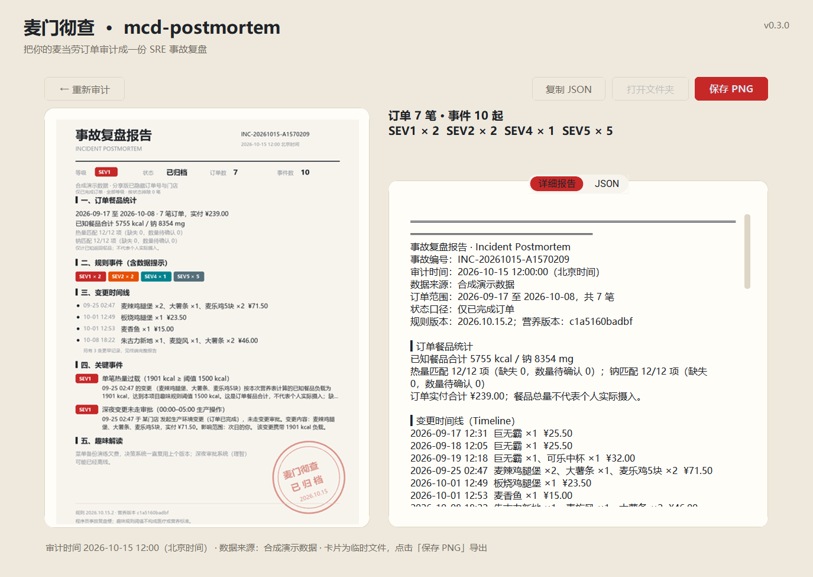

# mcd-postmortem · 麦门彻查 🍔📋

> 你的每一次点餐，都是一次生产环境变更。吃完之后，审计小组来写复盘。

 

把历史订单变成一份程序员风格的 SRE 事故复盘报告：确定性规则、订单证据、时间线、趣味解读和可分享 PNG 卡片。无需 LLM。


**目录**：[安装](#安装) · [桌面界面（GUI）](#桌面界面gui) · [用法](#用法) · [常用命令](#常用命令) · [七条规则](#七条规则) · [套餐与缺失数据](#套餐与缺失数据) · [可复现与分享](#可复现与分享) · [测试](#测试) · [维护](#维护)

## 安装

**方式一：下载 exe（Windows，免安装）**

从 [GitHub Releases](https://github.com/kdjdhe/mcd-postmortem/releases/latest) 下载，放到任意目录：

- **`mcd-postmortem-gui.exe`（推荐）**：双击打开桌面窗口，无需命令行。
- `mcd-postmortem.exe`：命令行版本，适合脚本与终端用户。

```powershell
.\mcd-postmortem.exe demo
.\mcd-postmortem.exe demo --card demo.png
```

exe 内置 Python 运行时与全部依赖，无需安装 Python。首次运行如遇 Windows SmartScreen 提示，点"更多信息 → 仍要运行"（未签名的个人开源程序常见提示）。也可用 PowerShell 解除锁定：`Unblock-File .\mcd-postmortem.exe`。

**方式二：pip 安装（需要 Python 3.10+）**

```bash
python -m pip install .
mcd-postmortem demo
mcd-postmortem demo --card demo.png
```

需要桌面界面时安装 GUI 可选依赖：`python -m pip install ".[gui]"`，然后运行 `mcd-postmortem-gui`。

Pillow 会随安装自动获得。Windows 自动使用系统中文字体；Linux 建议安装 Noto CJK，其他字体可通过 `MCD_FONT` 指定中文字体文件路径。

项目包含 `uv.lock`，使用 uv 可复现依赖安装：

```bash
uv sync --locked
uv run mcd-postmortem demo
```

## 桌面界面（GUI）

不想记命令的话，双击 `mcd-postmortem-gui.exe` 即可：



- 左侧按钮用合成数据一键演示；右侧粘贴 Token 即可审计真实订单。
- 审计在后台线程执行，窗口实时显示当前阶段，不会卡死。
- 结果页直接预览分享卡片，可保存 PNG、复制 JSON、打开所在文件夹。
- 高级选项：时间范围、严重级别、套餐口径、固定审计时间、全部状态、刷新缓存。



GUI 使用 CustomTkinter，Token 只保留在内存中，不写入磁盘。

## 用法

### 第一次体验：demo（无需 Token）

演示不需要 Token，订单与营养数据都是合成样例；默认审计基准固定在 **2026-10-15 12:00（北京时间）**，跨进程运行得到相同报告。可用 `--at` 把演示样例平移到另一个审计时间。

### 审计真实订单

在麦当劳官方 [MCP 控制台](https://open.mcd.cn/mcp) 申请 Token，通过环境变量传入。PowerShell：

```powershell
$env:MCD_MCP_TOKEN = "你的 Token"
mcd-postmortem audit
mcd-postmortem audit --since 30d --card my-report.png
```

Bash：

```bash
export MCD_MCP_TOKEN="你的 Token"
mcd-postmortem audit
```

配置示例见 [mcp-config.example.json](mcp-config.example.json)，WorkBuddy 使用说明见 [workbuddy.md](workbuddy.md)。

只使用 `order-list` 和 `list-nutrition-foods` 两个查询工具，客户端拒绝其他工具名。这是程序的调用边界，不代表账号 Token 本身具有只读权限。

`--since` 是相对审计时间的窗口，包含两端边界，不包含未来订单。默认审计所有已返回且不晚于审计时间的已完成订单；**不假设接口一定只返回近 30 天**。报告显示实际最早/最晚订单日期，并列出按状态排除的数量。未知状态默认排除，可用 `--all-statuses` 显式纳入。

## 常用命令

子命令只有两个：`audit`（审计真实历史订单）与 `demo`（合成数据演示，参数相同）。

```bash
# stdout 是纯 UTF-8 JSON，提示与错误写入 stderr
mcd-postmortem demo --json

# JSON 与 PNG 可同时生成
mcd-postmortem demo --json --card demo.png

# 最近两周、仅显示 SEV1；过滤等级不会改变订单统计范围
mcd-postmortem audit --since 2w --sev SEV1

# 固定审计时间，便于重现时间筛选和报告
mcd-postmortem audit --at 2026-10-15T12:00:00+08:00 --json

# 刷新营养缓存
mcd-postmortem audit --refresh-nutrition

# 明确需要查看未完成或未知状态订单时
mcd-postmortem audit --all-statuses
```

### 参数

| 参数 | 适用 | 说明 |
|---|---|---|
| `--since 30d` / `2w` | audit、demo | 相对审计时间的窗口，含两端边界 |
| `--sev SEV1..SEV5 / INFO` | audit、demo | 只显示指定级别，不改变统计范围 |
| `--at <ISO 时间>` | audit、demo | 固定审计时间（默认北京时间），用于复现 |
| `--json` | audit、demo | 标准输出仅写 JSON |
| `--card 文件.png` | audit、demo | 生成隐藏门店/订单号的 PNG 卡片 |
| `--all-statuses` | audit、demo | 纳入未完成/未知状态订单 |
| `--refresh-nutrition` | 仅 audit | 刷新七天营养缓存 |
| `--combo-quantities` | 仅 audit | 套餐子项数量口径：`unknown`（默认）/ `per-parent` / `per-order` |
| `--version` | 全局 | 打印版本 |

### 环境变量

| 变量 | 必需 | 说明 |
|---|---|---|
| `MCD_MCP_TOKEN` | audit 必需 | 麦当劳 MCP 控制台申请的 Token，缺失时 audit 报错退出 |
| `MCD_FONT` | 可选 | 中文字体文件路径，覆盖系统默认字体选择 |
| `NO_COLOR` / `FORCE_COLOR` | 可选 | 关闭 / 强制终端彩色输出 |

### 退出码

| 码 | 含义 |
|---|---|
| 0 | 正常完成 |
| 1 | 运行错误（Token 缺失、参数错误、接口失败等） |
| 2 | 不完整审计：有规则执行失败，产生 `ENGINE-*` 事件 |
| 130 | 用户中断（Ctrl+C） |

## 七条规则

| 等级 | 规则 | 口径 |
|---|---|---|
| SEV1 | 深夜变更 | 00:00 至 04:59 下单 |
| SEV1 | 餐品热量负载 | 订单已匹配部分 ≥ 1500 kcal |
| SEV2 | 单点依赖 | 同一顶层商品连续 ≥ 3 笔订单；中断重计，每段报告一次 |
| SEV2 | 短时间连续下单 | 相邻订单间隔大于 0、小于 10 分钟；不推断取消或替换 |
| SEV4 | 餐品钠负载 | 订单已匹配部分 ≥ 2400 mg |
| SEV5 | 午间到店窗口 | 11:30 至 12:59 到店订单；不推断真实排队时长 |
| INFO | 未建档数据 | 实际计量的餐品子项未匹配到营养条目 |

SEV 等级与数值阈值是趣味规则配置，不代表医学标准。订单可能供多人食用，餐品合计不代表个人实际摄入。资损规则 SEV3 暂未实现，也不以当前价格推断历史损失。

## 套餐与缺失数据

营养核算只用规范化精确名称匹配。有套餐子项时仅统计返回的子项，避免套餐父项和子项重复计量；不会把“巨无霸套餐”匹配成一个“巨无霸”。

多份套餐的子项数量含义在现有真实样本中尚未证实，默认 `unknown`：当父项数量大于 1 时，这些子项标记为“数量待确认”，不猜测营养总量。取得明确证据后可显式指定：

```bash
# 子项数量代表每份套餐：父项数量 × 子项数量
mcd-postmortem audit --combo-quantities per-parent

# 子项数量已是整单总数：不再乘父项数量
mcd-postmortem audit --combo-quantities per-order
```

报告和 JSON 分别显示热量/钠的匹配条目数、缺失数和数量待确认数。覆盖率以返回的计量条目为单位；仅说明返回数据的匹配情况，不证明套餐组成完整。全部未知时输出 JSON `null`，真实零值保留为 `0`。

营养数据缓存七天，位于 Windows `%LOCALAPPDATA%/mcd-postmortem/nutrition-v1.json` 或其他平台的 `$XDG_CACHE_HOME/mcd-postmortem/`（默认 `~/.cache/mcd-postmortem/`）。缓存过期/损坏时重新查询，也可主动刷新。JSON 中记录营养表内容摘要和规则版本；缓存不包含订单或 Token。

## 可复现与分享

相同订单、营养表、规则版本产生相同判定。若要整个报告一致，还需相同审计时间、筛选参数和输出环境。演示采用稳定编码；完整报告可通过 `--at` 固定时间。JSON 带 `schemaVersion`、`inputDigest`、`rulesetVersion` 和 `nutritionVersion`。

终端与 JSON 保留证据订单号，适合本地核对；PNG 分享版隐藏订单号与具体门店，仍包含日期、餐品和金额，请按自己的分享范围使用。演示卡片明确标注合成数据。任何规则执行失败都会产生 `ENGINE-*` 事件，并以退出码 2 标记不完整审计，即使等级过滤隐藏了该事件也不会静默成功。

## 测试

```bash
python -m pip install -e .
python -m unittest discover -s tests -v
```

回归测试覆盖连续段/非连续反例、订单去重、套餐数量口径、父子项去重、缺失与零值、状态过滤、跨进程复现、JSON 输出、缓存、客户端只读限制与 PNG 生成。测试只使用合成数据与模拟客户端。

## 维护

Windows 免安装 exe 用 PyInstaller 打包：CLI 用 `build_exe.bat`，桌面 GUI 用 `build_gui_exe.bat`。注意必须带 `--collect-submodules mcd_postmortem`——规则引擎用 `pkgutil.iter_modules` 动态发现规则模块，静态分析收不齐，漏了会静默少报事件。GUI 还需 `--collect-all customtkinter` 打包主题资源。

目标用户：喜欢 OnCall / SRE 复盘梗的程序员、想用一张报告回顾点餐习惯的人。本项目聚焦历史审计，点餐工作流可参考 mcd-git、MealCI 等项目。

项目为独立参赛作品，非麦当劳官方产品。[参赛声明](CONTEST_DECLARATION.md) · [MCP 集成说明](MCP_INTEGRATION.md) · [更新记录](CHANGELOG.md)
