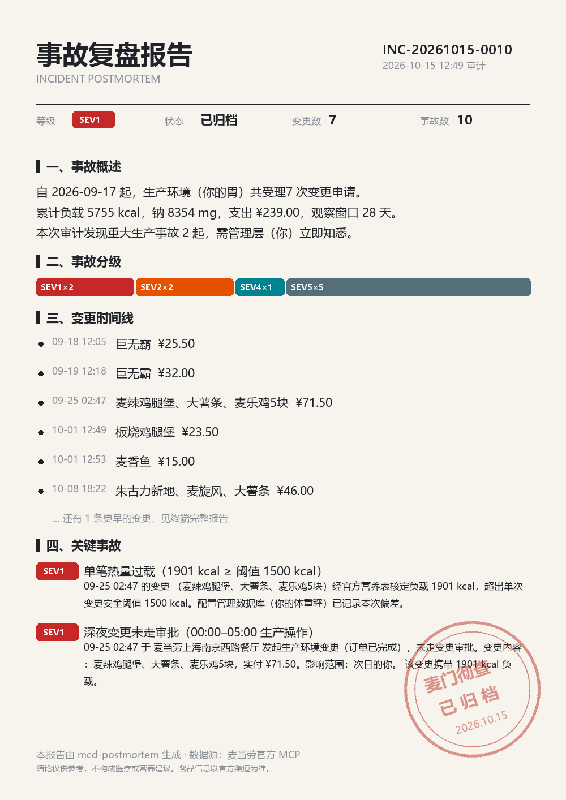

# mcd-postmortem · 麦门彻查 🍔📋

> 你的每一次点餐，都是一次生产环境变更。变更出了事故，就要有人写复盘报告。
>
> 基于麦当劳中国官方 [MCP 服务](https://open.mcd.cn/mcp) · 麦当劳程序员创意开发大赛参赛作品



## 这是什么

mcd-postmortem 把你的麦当劳历史订单当成**生产环境变更记录**来审计：确定性规则引擎扫描出"事故"（凌晨下单、热量过载、单点依赖、多付的钱……），生成一份**正经到反差的 SRE 事故复盘报告**——事故编号、SEV 分级、时间线、根因分析、Action Items，最后盖一个「麦门彻查·已归档」的红章。

**和"AI 帮你写小作文"项目的根本区别**：每个事故都由确定性规则触发，携带真实订单号证据链。同一份订单数据跑两遍，报告一字不差（有单测为证）。LLM 不参与判定，只有文风本身就是写死的吐槽模板。

| 事故等级 | 判定规则（纯代码，可 PR） | 示例 |
|---|---|---|
| **SEV1** 重大生产事故 | 00:00–05:00 下单；单笔 ≥ 1500 kcal | 「深夜变更未走审批，影响范围：次日的你」 |
| **SEV2** 单点故障 | 同一单品连续 ≥ 3 单；10 分钟内连续变更 | 「巨无霸已构成单点依赖，服务一旦下架将导致早午餐不可用」 |
| **SEV4** 隐患告警 | 单笔钠 ≥ 2400mg（日推荐上限） | 「容量规划（肾脏）已收到告警」 |
| **SEV5** 流程瑕疵 | 午高峰 11:30–13:00 到店自取 | 「高峰期变更需进入发布队列（排队取餐）」 |
| **INFO** 优秀实践/404 | 营养表未收录的"未纳管资产" | 「建议纳入 CMDB（营养表）管理」 |

## 安装

```bash
pip install -e .
export MCD_MCP_TOKEN="你的Token"   # https://open.mcd.cn/mcp 控制台申请
```

## 快速开始

```bash
# 没有Token？先看合成数据演示（零门槛）
mcd-postmortem demo

# 审计你的真实历史订单（终端报告）
mcd-postmortem audit

# 顺带生成可分享的 PNG 报告卡片
mcd-postmortem audit --card my_postmortem.png

# 只看重大事故 / 结构化输出
mcd-postmortem audit --sev SEV1
mcd-postmortem audit --json
```

终端报告长这样（`demo` 模式输出）：

```text
══════════════════════════════════════════════════════════
                    事 故 复 盘 报 告
══════════════════════════════════════════════════════════
  事故编号        INC-20261015-0010
  审计范围        近 30 天 7 笔生产变更（订单）
  事故总数        10 起  SEV1×2  SEV2×2  SEV4×1  SEV5×5

▍事故明细（按严重度排序）
  ▓▒░ SEV1  单笔热量过载（1901 kcal ≥ 阈值 1500 kcal）
        09-25 02:47 的变更经官方营养表核定负载 1901 kcal，
        配置管理数据库（你的体重秤）已记录本次偏差。
        证据: orderId=1030…
▍根因分析（Root Cause）
  观察期 5/7 次变更集中在午间决策疲劳窗口，决策系统降级为
  「上次吃啥这次还吃啥」模式；变更审批流程（理智）处于离线状态。
▍后续行动（Action Items）
  ☐ P0 为变更审批系统（理智）配置值班 schedule：00:00 后自动拒绝需求
```

## 目标用户

- 被 OnCall 和复盘文化双重摧残、从而获得梗的理解力的程序员
- 想知道"我这个月到底吃了多少钠"但不想直面现实的麦门信徒
- 需要一张图证明"我不是乱花钱，是系统性风险"的人

## 设计原则

1. **确定性**：规则即代码，同输入必同输出，每个结论可溯源到 `orderId + 触发规则 + 字段值`
2. **只读安全**：全部使用只读 MCP 工具（订单/营养/时间），不下单、不扣款、不改账户状态
3. **规则开源共建**：`mcd_postmortem/rules/` 一条规则一个文件，欢迎 PR 你的新事故类型（比如"疯狂星期四缺席"）

## 与其它点餐项目的差异

本项目**不做点餐流程**（下单/优惠计算请移步其他优秀项目），只做**事后审计**。git 工作流点餐请看 mcd-git，营养 lint 请看 MealCI——吃完之后想追责，来麦门彻查。

---

参赛声明见 [CONTEST_DECLARATION.md](CONTEST_DECLARATION.md) · MCP 集成说明见 [MCP_INTEGRATION.md](MCP_INTEGRATION.md)
